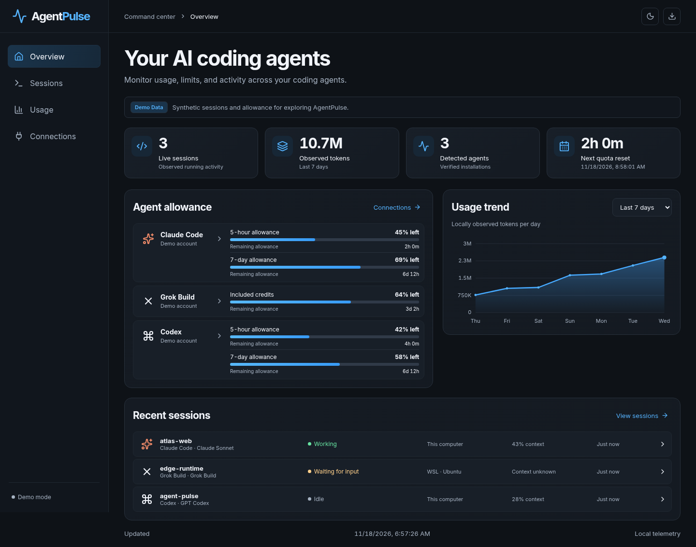

# AgentPulse

AgentPulse is a local command center for coding-agent sessions, provider allowance, and observed token usage.



## Run locally

Use Node 24.22.3 and pnpm 11.0.0. If pnpm is unavailable, run the commands via `npx --yes pnpm@11.0.0`. The local verification machine used Node 26.3.0 for standalone development. Electron 45.3.4 embeds Node 24.22.3.

```sh
pnpm install --frozen-lockfile
pnpm dev:desktop
```

| Mode | Run | Build |
| --- | --- | --- |
| Electron | `pnpm dev:desktop` | `pnpm build:desktop` |
| Live browser | `pnpm dev:web` | `pnpm build:web && pnpm build:collector` |
| Static demo | `pnpm dev:demo` | `pnpm build:demo` |

After building live web, run `node dist/collector/web.cjs`. Open `http://127.0.0.1:43129` and enter the one-time code from the private file printed by the companion. Run `pnpm exec vite preview --outDir dist/demo` to serve the built demo. The live renderer is packaged with the desktop companion. Both views share one collector on the same machine.

AgentPulse discovers recognized local CLI installations and checks their normal data roots automatically. Open **Connections** to see coverage, versions, and source availability. Claude can optionally emit live quota and context through the status-line bridge. AgentPulse keeps its metrics cache on your computer and uses existing provider authentication for supported account reads.

| Provider | Local coverage | Allowance |
| --- | --- | --- |
| Codex 0.170.0 | Rollout history and Linux terminal liveness | Live allowance and account summary verified on Linux x64 |
| Claude Code 2.1.294 | Transcript history and JSON session registry | Optional status line |
| Grok Build 1.0.89 | Completed turns and Linux terminal liveness | ACP experiment gated by an explicit environment flag |

See the [platform and provider matrix](docs/testing.md), [usage guide](docs/usage.md), [collector architecture](docs/architecture.md), [privacy boundaries](docs/privacy.md), [release procedure](docs/releases.md), and [development workflow](docs/development/workflow.md).

[Live Connections screenshot](docs/screenshots/live-connections.png) · [Synthetic mobile screenshot](docs/screenshots/demo-mobile.png)
